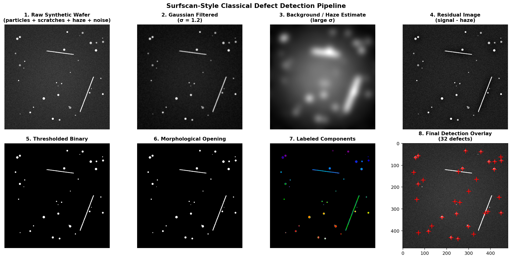
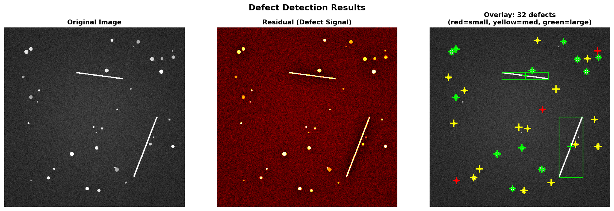
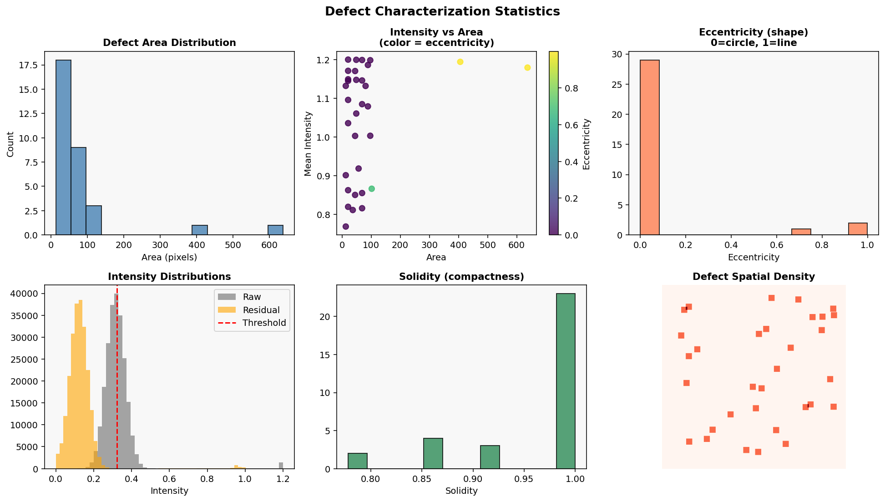
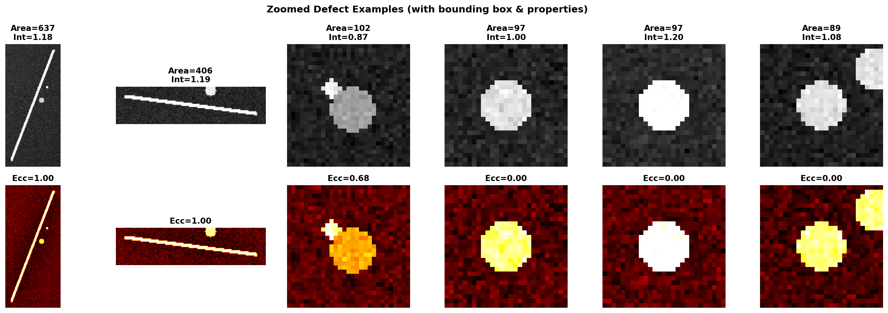

# Surfscan-Style Classical Wafer Defect Detection Demo

A self-contained Python script that generates a synthetic unpatterned wafer image and runs a classical image-processing pipeline for detecting particles and scratches. The script produces four high-resolution figures that illustrate every major step.

This is intended as a lightweight, interview-friendly example of the kind of detection and characterization work done on unpatterned wafer inspection systems.

## Requirements

```text
numpy
matplotlib
scipy
scikit-image
```

Install with:
```bash
pip install numpy matplotlib scipy scikit-image
```

## How to Run

Place the script in any folder and run:

```bash
python wafer_defect_demo_graphics_local.py
```

The four PNG figures are saved in the same folder as the script:

- `wafer_demo_pipeline.png`
- `wafer_demo_overlay.png`
- `wafer_demo_stats.png`
- `wafer_demo_zooms.png`

## What the Script Does

### 1. Synthetic Wafer Generation

The function `generate_synthetic_wafer` creates a 480 x 480 image that mimics a dark-field or residual image from an unpatterned wafer scan.

- Base surface intensity is approximately 0.28.
- A mild radial haze is added:
  ```
  haze = 0.08 * exp( -(X^2 + Y^2) / 0.7 )
  ```
- Particles are inserted as bright circular spots with random radii (roughly 1.8–5.5 pixels) and random intensities.
- Two scratches are drawn as bright linear features.
- Gaussian noise (standard deviation ≈ 0.045) is added and the image is clipped.

The result looks like a noisy wafer map containing both point defects (particles) and extended defects (scratches).

### 2. Detection Pipeline

The function `full_pipeline` performs the following classical steps:

1. **Gaussian filtering**  
   Smooth the image to reduce noise:
   ```
   blurred = Gaussian(image, sigma = 1.2)
   ```

2. **Background / haze estimation**  
   Estimate the slowly varying background with a much larger kernel:
   ```
   background = Gaussian(image, sigma = 15)
   residual = max(image - 0.6 * background, 0)
   ```
   Subtracting a fraction of the background removes the large-scale haze while preserving the localized defect signals.

3. **Thresholding**  
   Compute an automatic threshold with Otsu’s method on the residual image, then raise it slightly to reduce false positives:
   ```
   threshold = 1.15 * Otsu(residual)
   binary = residual > threshold
   ```

4. **Morphological opening**  
   Remove small noise blobs:
   ```
   opened = morphological_opening(binary, disk of radius 1)
   ```

5. **Connected-component analysis**  
   Label the remaining regions and extract properties (area, centroid, mean intensity, eccentricity, solidity, bounding box).  
   Keep only regions whose area is at least 6 pixels.

The returned dictionary contains every intermediate image plus the list of detected defects.

## Graphics Produced

### Figure 1 – Pipeline Overview (`wafer_demo_pipeline.png`)

Eight panels that show the image at each major stage:

1. Raw synthetic wafer  
2. Gaussian-filtered image (sigma = 1.2)  
3. Background / haze estimate (large sigma)  
4. Residual image (signal minus haze)  
5. Thresholded binary mask  
6. Morphological opening  
7. Labeled connected components (color-coded)  
8. Final detection overlay with red “+” markers

This figure is useful for explaining the progressive cleaning of the signal.

### Figure 2 – Detection Overlay (`wafer_demo_overlay.png`)

Three panels:

- Original image  
- Residual (defect signal) shown in a hot colormap  
- Final overlay with color-coded markers and bounding boxes  
  - Red = small defects (area < 20)  
  - Yellow = medium defects (area < 50)  
  - Lime/green = large defects  

Scratches appear as elongated green or yellow boxes; particles appear as small red or yellow crosses.

### Figure 3 – Statistics (`wafer_demo_stats.png`)

Six plots that characterize the detected defects:

- Histogram of defect area  
- Scatter plot of mean intensity versus area (color = eccentricity)  
- Histogram of eccentricity (0 = circular, 1 = line-like)  
- Intensity histograms of the raw image and the residual, with the threshold marked  
- Histogram of solidity (compactness)  
- Spatial density map of defect locations  

These plots illustrate how simple geometric and intensity features can separate particles from scratches.

### Figure 4 – Zoomed Defects (`wafer_demo_zooms.png`)

The largest defects are shown as close-up crops (raw image on top, residual on the bottom). Each crop is annotated with area, mean intensity, and eccentricity. Scratches appear long and thin; particles appear roughly circular.

## Key Equations

| Step                    | Equation / Rule                                      |
|-------------------------|------------------------------------------------------|
| Haze model              | haze = 0.08 * exp( -(X² + Y²) / 0.7 )               |
| Gaussian blur           | blurred = Gaussian(image, σ = 1.2)                   |
| Background estimate     | background = Gaussian(image, σ = 15)                 |
| Residual                | residual = max(image - 0.6 * background, 0)          |
| Threshold               | T = 1.15 * Otsu(residual)                            |
| Binary mask             | binary = residual > T                                |
| Opening                 | opened = opening(binary, disk radius = 1)            |
| Minimum area            | keep region if area ≥ 6 pixels                       |

## Discussion

- The pipeline deliberately separates large-scale haze from localized defect signals before thresholding.
- Morphological opening and a minimum-area filter control false positives caused by noise.
- Eccentricity and solidity are simple, effective features for distinguishing particles (compact, low eccentricity) from scratches (elongated, high eccentricity).
- All of the intermediate images are retained so that performance can be characterized and parameters can be tuned.
- The same ideas extend naturally to multi-channel data, adaptive thresholds, or a lightweight classifier trained on the extracted features.
- In production the hot loops (filtering, residual calculation, labeling) would typically be accelerated with SIMD/AVX or CUDA for the required throughput.

## Customization

You can change the synthetic data or the algorithm parameters near the bottom of the script:

```python
img, particle_locs = generate_synthetic_wafer(
    size=480, n_particles=35, n_scratches=2, noise_level=0.045
)
```

Inside `full_pipeline` you can adjust the blur sigma, the background subtraction factor (0.6), the threshold multiplier (1.15), or the minimum area.


